<h2>TensorFlow-FlexUNet-Image-Segmentation-Breast-Malignant-Tumor-MRI (2026/11/21)</h2>
<h3>Breast-Malignant-Tumor-MRI: AI Generated Pseudo Masks Segmentation Challenge</h3>
Toshiyuki Arai 
Software Laboratory antillia.com  
This is the first experiment of Image Segmentation for <b>Breast-Malignant-Tumor-MRI </b>
 based on
our <a href="https://github.com/sarah-antillia/TensorFlow-FlexUNet-Image-Segmentation-Model">TensorFlowFlexUNet Model</a>
 (<b>TensorFlow Flexible UNet Image Segmentation Model for Multiclass</b>) and a 512x512-pixel PNG
<a href="https://drive.google.com/file/d/1lgwvj7C3GNGIWHfhiEpxwIt1ME0zzzkx/view?usp=sharing">
<b>Breast-Malignant-Tumor-MRI-ImageMask-Datasaet.zip</b></a>
 (<a href="https://www.mit.edu/~amini/LICENSE.md">MIT</a>
) derived  by us from the Kaggle
  
<a href="https://www.kaggle.com/datasets/abenjelloun/breast-mri-tumor-classification-dataset">
<b>Breast MRI Tumor Classification Dataset
</b>
</a> by A.Benjelloun.
  

<b>Actual Image Segmentation for Breast-Malignant-Tumor-MRI Images of 512x512 pixels</b> 
As shown below, the inferred masks resemble the ground-truth masks.  
 
 
<table>
<tr>
<th width="320" height="auto">Input: image</th>
<th width="320" height="auto">Mask (ground_truth)</th>
<th width="320" height="auto">Prediction: inferred_mask</th>
</tr>
<tr>
<td>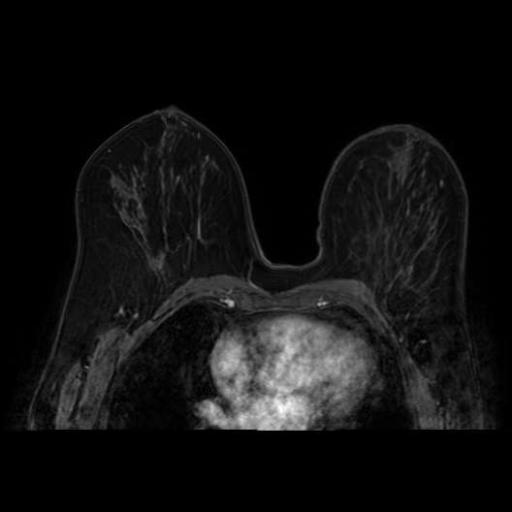</td>
<td></td>
<td></td>
</tr>
<tr>
<td>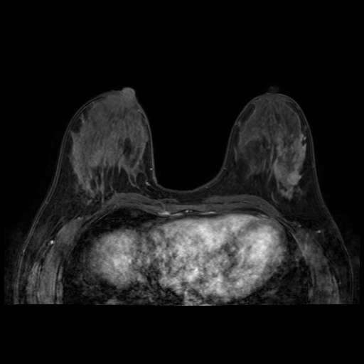</td>
<td></td>
<td></td>
</tr>
<tr>
<td>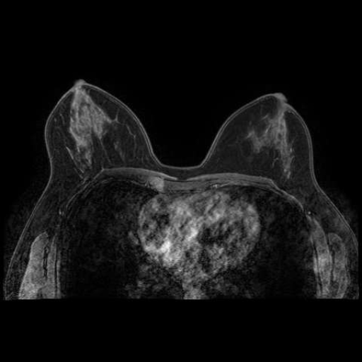</td>
<td></td>
<td></td>
</tr>
</table>

 
<h3>1. Dataset Citation</h3>
The dataset used here was derived from the following Kaggle:  

<a href="https://www.kaggle.com/datasets/abenjelloun/breast-mri-tumor-classification-dataset">
<b>Breast MRI Tumor Classification Dataset
</b>
</a>  
<b>MRI-based dataset for classifying breast tumors into benign and malignant
</b>
  by A.Benjelloun.
  
The following explanation was taken from the website above. 
  
<b>About Dataset</b> 
<b>Dataset Description</b> 
This dataset contains breast MRI images curated from The Cancer Imaging Archive (TCIA) Breast 
Diagnosis collection source: https://www.cancerimagingarchive.net/collection/breast-diagnosis/.
  
Originally, the full collection included over 101,000 medical images across different modalities 
such as MRI, CT, PET, MG, along with clinical metadata including Diagnosis, Molecular Test, 
Demographic, Pathology Detail, Radiomic Feature, and Measurement. For the purpose of this study, 
we filtered and retained only the MRI images to focus specifically on breast tumor classification.
  
It includes two sets of images(each contains almost 25,000 MRI scans):
<ul>
<li>Preprocessed images resized to 224x224 pixels suitable for deep learning model training and experimentation.
</li>
<li>
Original resolution images preserving full detail for further analysis or custom preprocessing.
</li>
</ul>
The dataset was carefully cleaned and prepared following these steps:
<ul>
<li>
Filtering MRI series to retain only MR modality images from the original multi-modality collection.
</li>
<li>
Transposing and correcting metadata tables that were initially disorganized (rows and columns flipped).
</li>
<li>
Deriving a clear classification label (“Benign” or “Malignant”) for each patient using keyword-based mapping on the Pathology column, supplemented by manual review of clinical reports when data was missing or ambiguous.
</li>
<li>
Removing entries with missing values in critical metadata fields to ensure data quality and reliable labels.
</li>
<li>
Linking each MRI series to the corresponding patient-level diagnosis to create labeled samples.
</li>
</ul>
<b>Official TCIA Citation</b> 
Bloch, B. Nicolas, Jain, Ashali, & Jaffe, C. Carl. (2015). BREAST-DIAGNOSIS [Data set].  
The Cancer Imaging Archive. http://doi.org/10.7937/K9/TCIA.2015.SDNRQXXR
  
<b>License</b> 
<a href="https://www.mit.edu/~amini/LICENSE.md">MIT</a>
 
 
<h3>
2. Breast-Malignant-Tumor-MRI ImageMask Dataset
</h3>
<h3>2.1 Download ImageMask Dataset</h3>
 If you would like to train this Breast-Malignant-Tumor-MRI Segmentation model,
 please download the dataset from the Google Drive 
<a href="https://drive.google.com/file/d/1lgwvj7C3GNGIWHfhiEpxwIt1ME0zzzkx/view?usp=sharing">
<b>Breast-Malignant-Tumor-MRI-ImageMask-Datasaet.zip</b>.
</a> 
Expand the downloaded and put it under the <b>./dataset</b> folder.
 
<pre>
./dataset
└─Breast-Malignant-Tumor-MRI
    ├─test
    │   ├─images
    │   └─masks
    ├─train
    │   ├─images
    │   └─masks
    └─valid
         ├─images
         └─masks
</pre>
 
<b>Breast-Malignant-Tumor-MRI Statistics</b> 
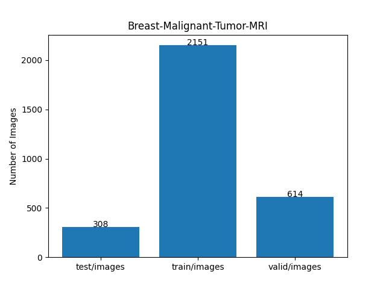 
 
As shown above, the number of images in the training and valid datasets is large enough to use for the
 training set of our segmentation model.
 
<h3>2.2 Derivation of ImageMask Dataset</h3>
The folder structure of the original breast_mri_dataset is as follows, but it contains no annotation (mask) files.
<pre>
./breast_mri_dataset
    ├─test
    │   ├─Benign
    │   └─Malignant
    ├─train
    │   ├─Benign
    │   └─Malignant
    └─val
         ├─Benign
         └─Malignant
</pre>
<b>Step 1</b> 
We generated a 512x512-pixel PNG master images from the JPG files in 
<b>train/Malignant</b> subfolder.
  
<b>Step 2</b> 
We generated the first pseudo masks corresponding to the master images
by applying a segmentation (inference) method of the pretrained model 
<a href="https://github.com/sarah-antillia/TensorFlow-FlexUNet-Image-Segmentation-BreastDM-DCE-MRI">
TensorFlow-FlexUNet-Image-Segmentation-BreastDM-DCE-MRI
</a> to the master images.
  
<b>Step 3</b> 
We generated an ImageMask dataset from all pairs of the first pseudo masks and the master images.
  
<b>Step 4</b> 
We generated a new pretrained FlexUNet segmentation model by using the ImageMask 
dataset derived at Step 3.
  
<b>Step 5</b> 
We generated the new pseudo masks corresponding to the master images by applying a segmentation method of the new 
pretrained FlexUNet model obtained at Step 4.
  
We iteratively repeated Step3 to 5 two times to generate our own ImageMaskDataset.
  
<h3>2.3 Train Sample Images and Masks</h3>
<b>Train_sample_images</b> 
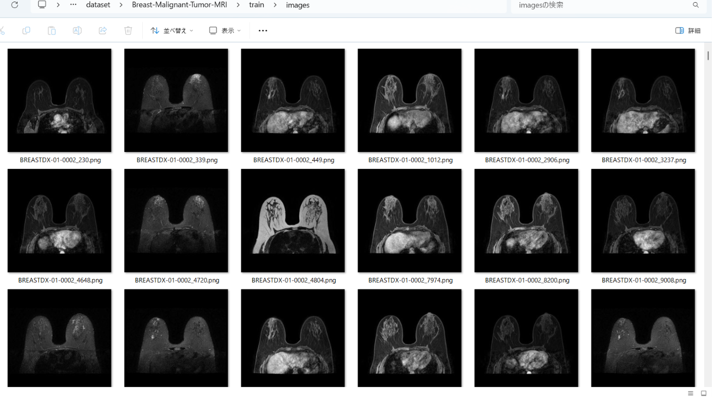
 
<b>Train_sample_masks</b> 
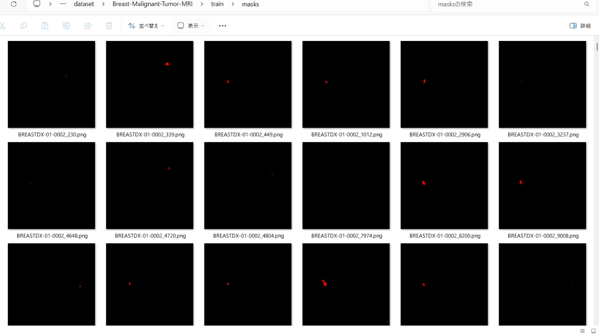
 
<h3>
3. Train TensorFlowFlexUNet Model
</h3>
 We trained the Breast-Malignant-Tumor-MRI TensorFlowFlexUNet model using the following
<a href="./projects/TensorFlowFlexUNet/Breast-Malignant-Tumor-MRI/train_eval_infer.config"> <b>train_eval_infer.config</b></a> file.  
Please move to ./projects/TensorFlowFlexUNet/Breast-Malignant-Tumor-MRI and run the following bat file. 
<pre>
>1.train.bat
</pre>
This runs the following command. 
<pre>
>python ../../../src/TensorFlowFlexUNetTrainer.py ./train_eval_infer.config
</pre>

<b>Model parameters</b> 
Defined a small <b>base_filters=16 </b> and large <b>base_kernels=(11,11)</b> for the first Conv Layer of Encoder Block of 
<a href="./src/TensorFlowFlexUNet.py">TensorFlowFlexUNet.py</a> 
and a large <b>num_layers=8</b> (including a bridge between Encoder and Decoder Blocks).
<pre>
[model]
; You may specify your own UNet class derived from our TensorFlowFlexModel
model         = "TensorFlowFlexUNet"
generator     =  False
image_width    = 512
image_height   = 512
image_channels = 3
num_classes    = 2
base_filters   = 16
base_kernels   = (11,11)
num_layers     = 8
dropout_rate   = 0.05
dilation       = (1,1)
</pre>
<b>Learning rate</b> 
Defined a small learning rate.  
<pre>
[model]
learning_rate  = 0.00007
</pre>
<b>Loss and metrics functions</b> 
Specified "categorical_focal_dice_loss" and <a href="./src/dice_coef_multiclass.py">"dice_coef_hybrid"</a>. 
<pre>
[model]
loss           = "categorical_focal_dice_loss"
metrics        = ["dice_coef_hybrid"]
hybrid_alpha   = 1.4
hybrid_beta    = 0.6
</pre>
<b>Dataset class</b> 
Specified <a href="./src/ImageCategorizedMaskDataset.py">ImageCategorizedMaskDataset</a> class. 
<pre>
[dataset]
class_name    = "ImageCategorizedMaskDataset"
</pre>
 
<b>Learning rate reducer callback</b> 
Enabled the learning_rate_reducer callback and a small reducer_patience.
<pre> 
[train]
learning_rate_reducer = True
reducer_factor     = 0.4
reducer_patience   = 4
</pre>
<b>Early stopping callback</b> 
Enabled early stopping callback with the patience parameter.
<pre>
[train]
patience      = 10
</pre>
<b>RGB Color map</b> 
Specified RGB color map dict for Breast-Malignant-Tumor-MRI 1+1 classes. 
<pre>
[mask]
mask_datatyoe    = "categorized"
mask_file_format = ".png"
;Breast-Malignant-Tumor-MRI RGB color map dict for 1+1 classes.
; Background: black,  Malignant-Tumor: red
rgb_map = {(0,0,0):0,(255,0,0):1}
</pre>
<b>Epoch change inference callback</b> 
Enabled <a href="./src/EpochChangeInferencer.py">epoch_change_infer callback</a></b>. 
<pre>
[train]
epoch_change_infer       = True
epoch_change_infer_dir   =  "./epoch_change_infer"
num_infer_images         = 6
</pre>
By using this callback, on every epoch change, the inference procedure can be called
 for 6 images in the <b>mini_test</b> folder. This will help you confirm how the predicted mask changes 
 at each epoch during your training process.  
  
<!--
As shown below, early in the model training, the predicted masks from our FlexUNet segmentation model showed 
discouraging results.
 However, as training progressed through the epochs, the predictions gradually improved. 
   
 
-->
<b>Epoch_change_inference output at starting (epoch 1,2,3)</b> 
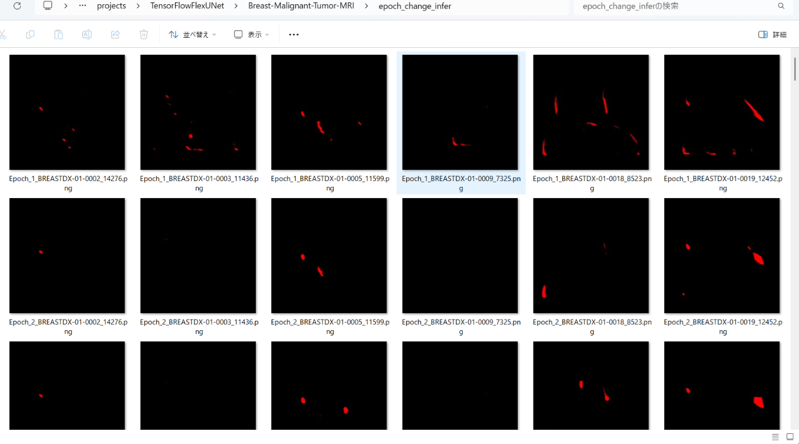 
 
<b>Epoch_change_inference output at middlepoint (epoch 19,20,21)</b> 
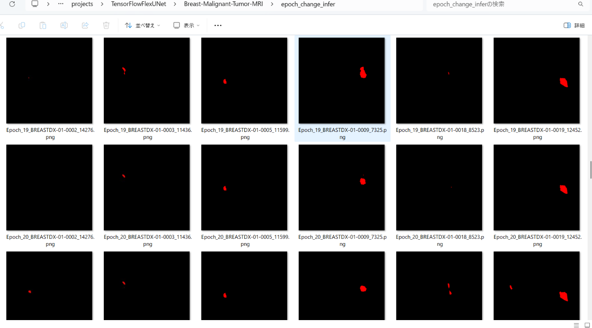 
 
<b>Epoch_change_inference output at ending (epoch 39,40,41)</b> 
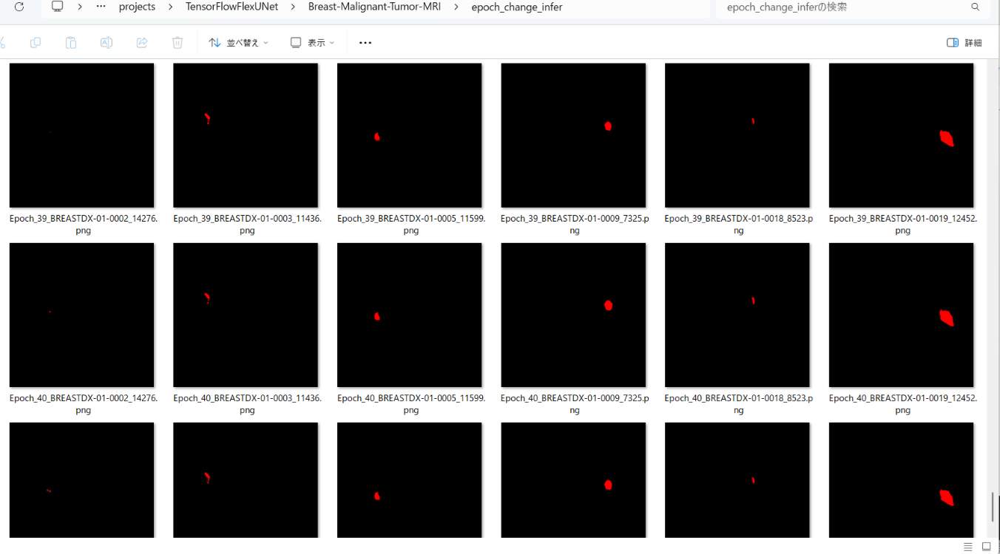 
 
In this experiment, the training process was stopped at epoch 41 by EarlyStoppingCallback. 
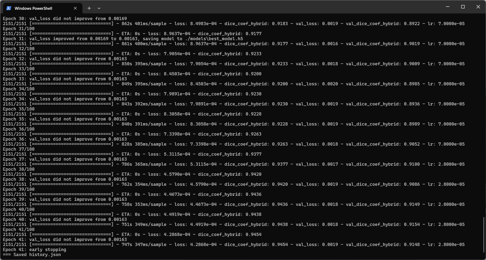 
 
<a href="./projects/TensorFlowFlexUNet/Breast-Malignant-Tumor-MRI/eval/train_metrics.csv">train_metrics.csv</a> 
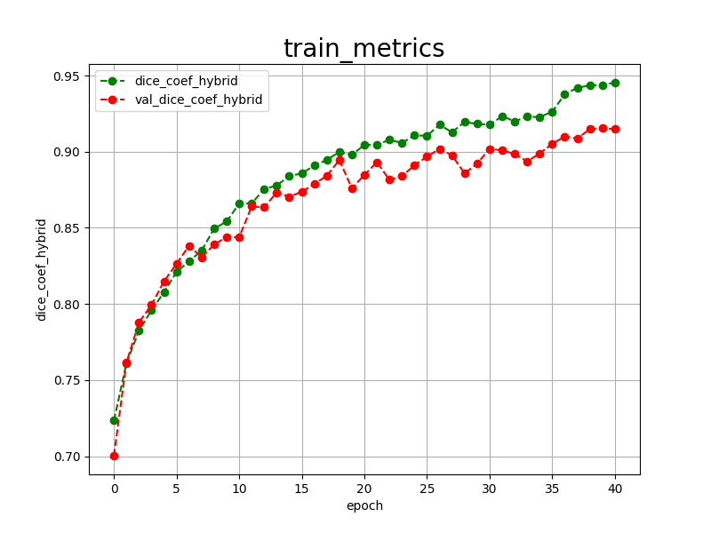 
 
<a href="./projects/TensorFlowFlexUNet/Breast-Malignant-Tumor-MRI/eval/train_losses.csv">train_losses.csv</a> 
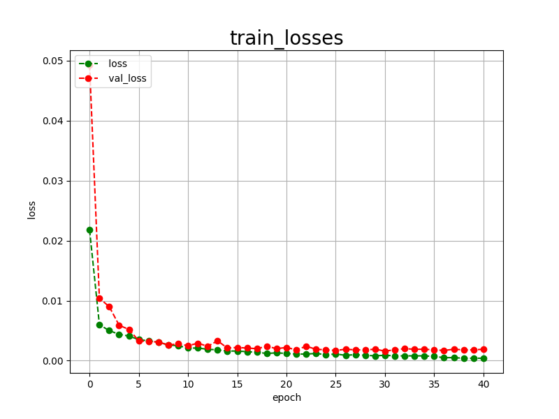 
 
<h3>
4. Evaluation
</h3>
Please move to <b>./projects/TensorFlowFlexUNet/Breast-Malignant-Tumor-MRI</b> folder,
and run the following bat file to evaluate the TensorFlowUNet model for Breast-Malignant-Tumor-MRI. 
<pre>
>./2.evaluate.bat
</pre>
This runs the following command.
<pre>
>python ../../../src/TensorFlowFlexUNetEvaluator.py ./train_eval_infer.config
</pre>
Evaluation console output: 
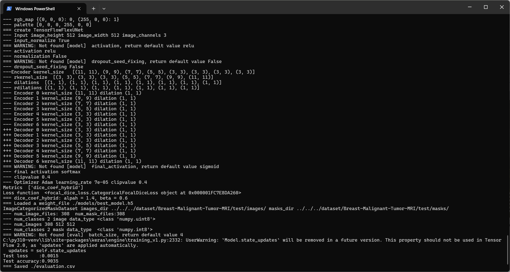
  Image-Segmentation-Breast-Malignant-Tumor-MRI

<a href="./projects/TensorFlowFlexUNet/Breast-Malignant-Tumor-MRI/evaluation.csv">evaluation.csv</a> 
The loss (categorical_focal_dice_loss) on this Breast-Malignant-Tumor-MRI/test was very low, 
but dice_coef_hybrid was not so high,
 as shown below.
 
<pre>
categorical_focal_dice_loss,0.0015
dice_coef_hybrid,0.9035
</pre>
 
<h3>
5. Inference
</h3>
Please move to <b>./projects/TensorFlowFlexUNet/Breast-Malignant-Tumor-MRI</b> folder
and run the following bat file to infer segmentation regions for images using the trained TensorFlowUNet model for Breast-Malignant-Tumor-MRI. 
<pre>
>./3.infer.bat
</pre>
This runs the following command.
<pre>
>python ../../../src/TensorFlowFlexUNetInferencer.py ./train_eval_infer.config
</pre>

<b>mini_test_images</b> 
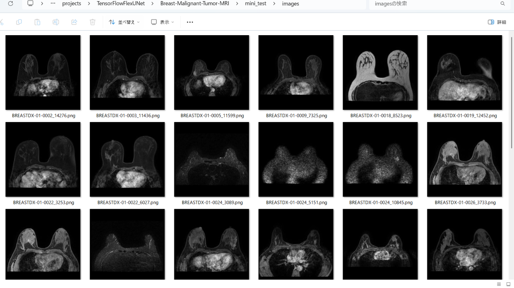 
<b>mini_test_mask(ground_truth)</b> 
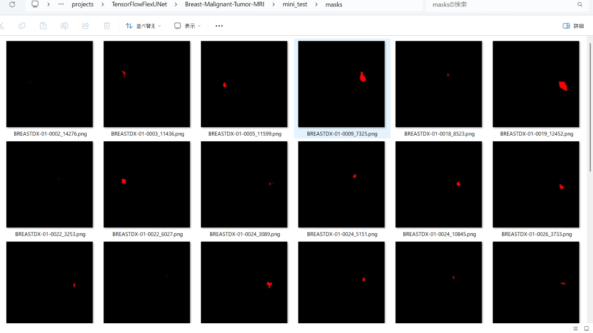 

<b>Inferred test masks</b> 
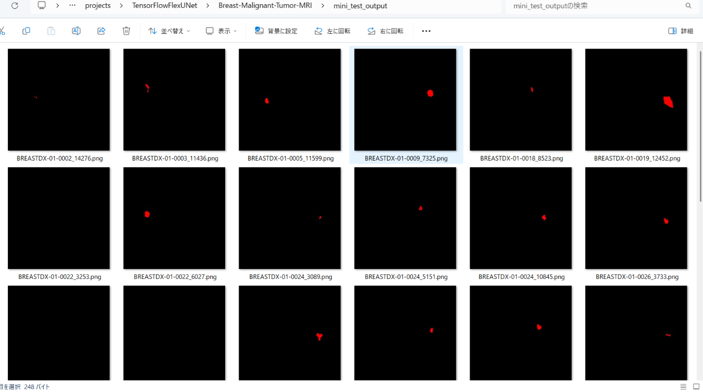 
 

<b>Enlarged images and masks for Breast-Malignant-Tumor-MRI Images of 512x512 pixels</b> 
As shown below, the inferred masks look similar to the ground truth masks except for the third and 
sixth cases. 
  
<table>
<tr>
<th width="320" height="auto">Image</th>
<th width="320" height="auto">Mask (ground_truth)</th>
<th width="320" height="auto">Inferred-mask</th>
</tr>
<tr>
<td>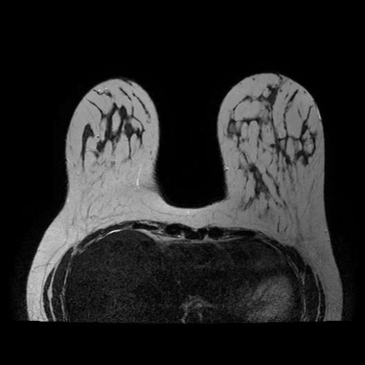</td>
<td></td>
<td></td>
</tr>
<tr>
<td>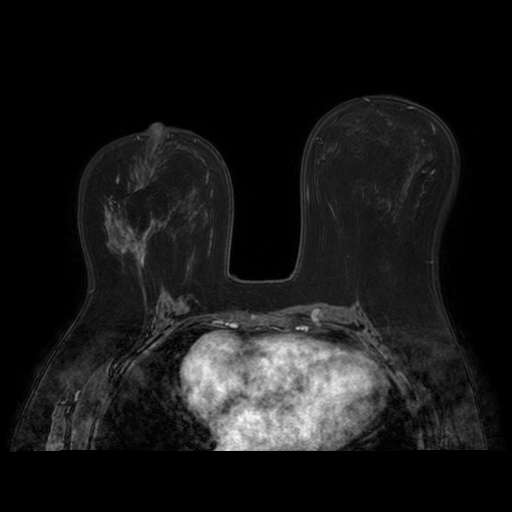</td>
<td></td>
<td></td>
</tr>
<tr>
<td>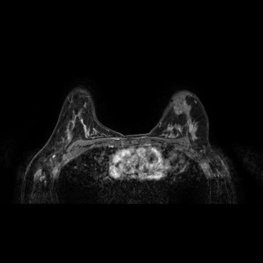</td>
<td></td>
<td></td>
</tr>
<tr>
<td>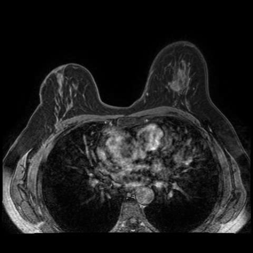</td>
<td></td>
<td></td>
</tr>
<tr>
<td>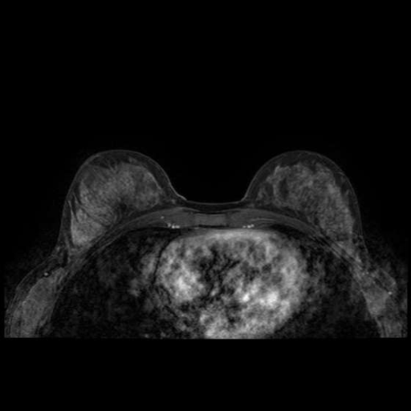</td>
<td></td>
<td></td>
</tr>
<tr>
<td>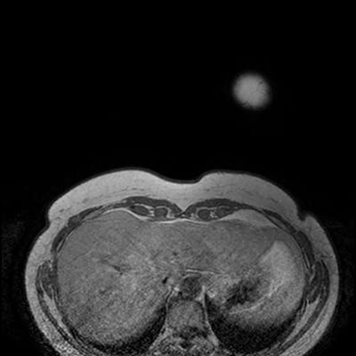</td>
<td></td>
<td></td>
</tr>
</table>

 
<h3>
References
</h3>
<b>1. BreastDM: A DCE-MRI dataset for breast tumor image segmentation and classification</b> 
Xiaoming Zhao, Yuehui Liao, Jiahao Xie, Xiaxia He, Shiqing Zhang, Guoyu Wang  , Jiangxiong Fang
, Hongsheng Lu, Jun Yu  
<a href="https://doi.org/10.1016/j.compbiomed.2023.107255">https://doi.org/10.1016/j.compbiomed.2023.107255</a> 
<a href="https://www.sciencedirect.com/science/article/abs/pii/S0010482523007205">
https://www.sciencedirect.com/science/article/abs/pii/S0010482523007205</a>
 
 
<b>2. Tensorflow-Image-Segmentation-Malignant-BreastDM</b> 
Toshiyuki Arai  
<a href="https://github.com/sarah-antillia/Tensorflow-Image-Segmentation-Malignant-BreastDM">
https://github.com/sarah-antillia/Tensorflow-Image-Segmentation-Malignant-BreastDM
</a>
 
 
<b>3. TensorFlow-FlexUNet-Image-Segmentation-BreastDM-DCE-MRI</b> 
Toshiyuki Arai 
<a href="https://github.com/sarah-antillia/TensorFlow-FlexUNet-Image-Segmentation-BreastDM-DCE-MRI">
https://github.com/sarah-antillia/TensorFlow-FlexUNet-Image-Segmentation-BreastDM-DCE-MRI
</a>
  
<b>4. TensrFlow-FlexUNet-Image-Segmentation-Model</b> 
Toshiyuki Arai 
<a href="https://github.com/sarah-antillia/TensorFlow-FlexUNet-Image-Segmentation-Model">
https://github.com/sarah-antillia/TensorFlow-FlexUNet-Image-Segmentation-Model
</a>
  
